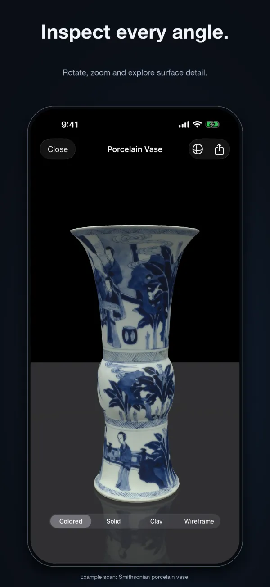
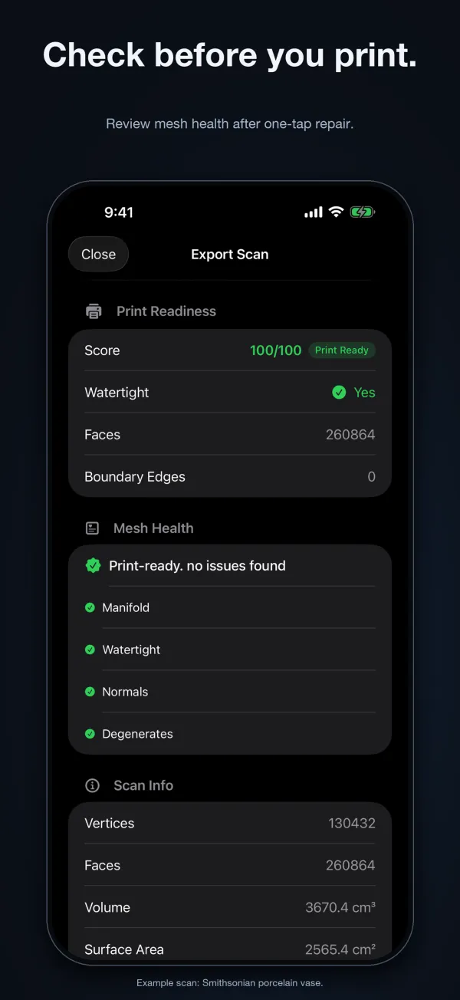

# 3D Scan Pro

Scan real-world objects and repair 3D meshes for printing on iPhone.

3D Scan Pro captures real objects using LiDAR and camera photogrammetry, removes floor and table geometry, and repairs meshes for 3D printing. It is built for 3D printing hobbyists, makers, designers, and collectors working on iPhone and iPad. Free to download. Optional one-time Pro Unlock, $9.99.

- Website: https://workmanl.github.io/3D-Scan-Pro/
- App Store: https://apps.apple.com/us/app/3d-scan-pro-mesh-generator/id6761485482
- Support: https://github.com/workmanl/3D-Scan-Pro/issues
- Email: hello@emrldlabs.com
- Privacy: https://workmanl.github.io/3D-Scan-Pro/privacy.html

## About this repository

The app's source code is not public. This repository is used for support: please open an issue for bug reports and questions.
